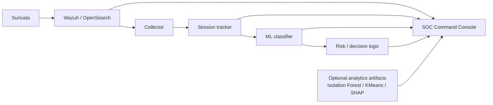

# CyberDeceptionAI — SOC Intelligence Console

An analyst-facing **security analytics console** for exploring OT/ICS cyber-deception telemetry, ML outputs and decision context in one place.

This repository is intentionally different from the adaptive-deception project: the focus here is not “autonomous defense”, but **visibility** — collecting signals, structuring sessions, surfacing model outputs and helping an analyst understand what the system is seeing.

## What it includes

- **Streamlit SOC Command Console** with dark, analyst-oriented UI
- Wazuh / Suricata alert views with frozen-vs-live source labelling
- session-oriented exploration of attacker activity
- Random Forest / Gradient Boosting training prototype for alert classification
- dashboard support for Isolation Forest, KMeans and SHAP artifacts when provided
- risk / decision-engine logs and analyst-facing context
- clearly-labelled demo fallbacks so the dashboard can still be explored without the original lab

## Architecture



More detail: [`docs/ARCHITECTURE.md`](docs/ARCHITECTURE.md)

## Quick start — dashboard

```bash
cd soc_dashboard
python -m venv .venv
# Windows: .venv\Scripts\activate
# Linux/macOS: source .venv/bin/activate
pip install -r requirements.txt
streamlit run app.py
```

If no real data files are available, the console runs with **clearly-labelled demo fallback data**. This is deliberate; demo values are not presented as real telemetry.

To point it to your own exports:

```bash
# Linux/macOS
export SOC_DATA_DIR=/path/to/exports
streamlit run app.py
```

See [`docs/DATA_SOURCES.md`](docs/DATA_SOURCES.md) for the supported file schemas.

## AI pipeline prototype

The `ai_pipeline/` folder contains the supporting prototype for:

`Wazuh alerts → sessionization → features → classification → risk/decision context`

Install its dependencies:

```bash
cd ai_pipeline
pip install -r requirements.txt
```

Train/export the classifier bundle from your own `dataset_ia.jsonl`:

```bash
TRAINING_DATASET=/path/to/dataset_ia.jsonl python module2_classification.py
```

Then the live pipeline can load the generated model bundle from `ai_pipeline/models/model_extended.pkl`.

## Public-safe configuration

The original prototype was built in an isolated lab. This public version removes the original telemetry, credentials, model binaries and private lab addresses.

Copy `.env.example` values into your environment as appropriate. **Remote Conpot actions are disabled by default** and should only be enabled in a lab you own/control.

## Scope

This is a prototype / portfolio project, not a production SOC product. In particular:

- the V1 analyst assistant is rule-based rather than LLM-driven;
- dashboard health indicators are not live infrastructure probes;
- model predictions are decision support, not proof of an attack;
- the console is read-only and does not itself enforce network controls.

See [`docs/LIMITATIONS.md`](docs/LIMITATIONS.md) for the full scope.

## Tech

`Python` · `Streamlit` · `Pandas` · `NumPy` · `Plotly` · `Scikit-learn` · `Wazuh` · `Suricata` · `Conpot` · `OT/ICS`

## Author

**Salma Ait Dada** — AI & Data Science · Security Analytics · Software Engineering
