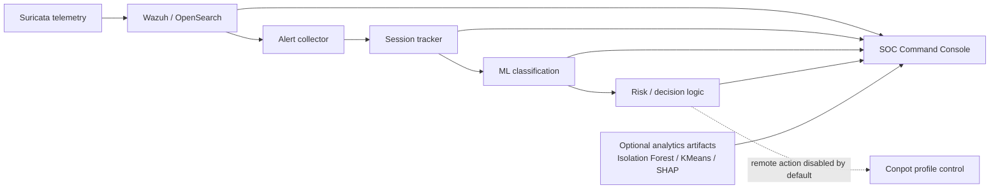

# Architecture

This repository focuses on the **analyst-facing SOC / security analytics view** of the cyber-deception work.

## Design intent

- **Console first:** the Streamlit dashboard is a read-only visualization layer.
- **Evidence-aware:** each source can be real or a clearly-labelled fallback.
- **Separation of concerns:** collection, sessionization, classification, decision logic and visualization are separate modules.
- **Public-safe defaults:** real credentials, private telemetry and lab IPs are not shipped; remote actions are disabled by default.
